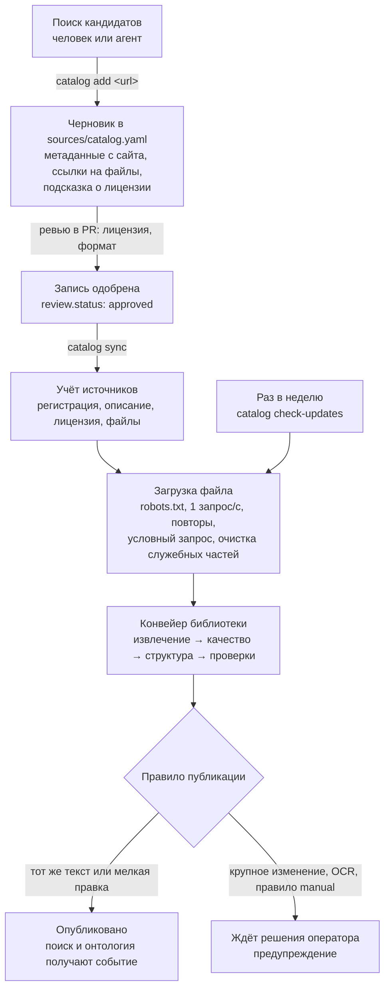

# Загрузка источников

Как источник попадает в библиотеку и как поддерживается в актуальном виде. Требования — в спецификации `source-catalog` (`openspec/changes/source-catalog/specs/source-catalog/spec.md`, после архивации — `openspec/specs/source-catalog/spec.md`). Почему выбран каталог в репозитории, а не автоматический обход сайтов, объясняет [ADR-0003](adr/0003-source-catalog.md).

## Схема



## Что где лежит

| Что | Где | Кто меняет |
|---|---|---|
| Список изданий: ссылка, адаптер, вид, раздел, правило публикации | `sources/catalog.yaml` | человек или агент через PR |
| Формат записи | `sources/catalog.schema.json` (JSON Schema) | разработчик |
| Виды лицензий и их разрешения | `sources/licenses.yaml` | разработчик |
| Все когда-либо выданные идентификаторы записей | `sources/catalog.lock.json` | команда `add` и сохранение каталога |
| Метаданные с сайта | `harvested` в записи | только адаптер (`add`, `harvest`) |
| Правки человека | `override` в записи | человек; адаптер их не трогает |
| Снимки файлов | FileStore (`PHILOGRAPH_FILES_ROOT`), по хешу содержимого | конвейер |
| Связь записи с источником учёта | таблица `library.catalog_links` | `sync` |
| ETag, Last-Modified, хеш, неудачи подряд, конечный адрес | таблица `library.fetch_state` | загрузчик |

Тексты в репозиторий не кладутся: только метаданные и ссылки.

## Запись каталога

```yaml
- id: locke-essay-concerning-humane-understanding-volume   # постоянный, не переиспользуется
  landing_url: https://www.gutenberg.org/ebooks/10615
  adapter: gutenberg            # gutenberg | wikisource | archive_org | direct
  kind: primary                 # textbook | primary | reference
  section: epistemology
  harvested:                    # пишет адаптер
    at: '2026-11-06T10:00:00+00:00'
    adapter_version: 1
    metadata:
      title: An Essay Concerning Humane Understanding, Volume 1
      authors: [{name: John Locke, death_year: 1704, wikidata: null}]
      language: en
      year: null
      translator: null
      publisher: Project Gutenberg
    files:
    - {name: pg10615.epub, url: 'https://www.gutenberg.org/ebooks/10615.epub3.images', clean: gutenberg}
    license_hint: Public domain in the USA.
  override:                     # правки человека, важнее harvested
    metadata: {year: 1690}
  license:
    kind: public-domain         # код из licenses.yaml
    basis: public_domain        # public_domain | open_license | rightsholder_permission
    evidence: 'сайт: Public domain in the USA.; John Locke ум. 1704'
  review: {status: approved, by: operator, at: '2026-11-06', note: null}
  publish: auto                 # auto | manual
```

## Команды

Все команды: `python -m philograph.library.catalog <команда>`. Для `sync`, `check-updates` и `status` нужны `PHILOGRAPH_DATABASE_URL` и `PHILOGRAPH_FILES_ROOT`.

| Команда | Что делает |
|---|---|
| `add <url> --kind primary [--section epistemology]` | выбирает адаптер по сайту, собирает метаданные и ссылки на файлы, дописывает годы смерти из Wikidata, предлагает лицензию; запись — черновик |
| `harvest [--id ID]` | заново собирает данные с сайта и печатает, что изменилось; `override` не трогает |
| `approve ID … [--by NAME]` | одобряет записи |
| `validate` | схема, повторы идентификаторов и ссылок, одобренные без лицензии, арифметика общественного достояния, исчезнувшие записи; запускается в CI |
| `sync [--id ID] [--dry-run]` | приводит библиотеку к каталогу и печатает итог по каждой записи |
| `check-updates` | проверяет файлы связанных записей и применяет правило публикации |
| `status` | одобрение, источник, состояние последней версии, публикация, неудачи загрузки, ошибка |

## Адаптеры

| Адаптер | Сайт | Метаданные | Файл |
|---|---|---|---|
| `gutenberg` | gutenberg.org/ebooks/N | RDF книги: название, авторы и годы смерти, переводчик, язык, права | EPUB3, иначе TXT; без разделов `pg-header` и `pg-footer` |
| `wikisource` | \*.wikisource.org/wiki/… | шаблон «Отексте» или `header` в вики-тексте, авторы через Wikidata | HTML главной страницы и подстраниц через REST API (`/api/rest_v1/page/html/…`) в порядке оглавления; без шапки и служебных блоков. ws-export закрыт для программ в robots.txt и не используется |
| `archive_org` | archive.org/details/… | API `metadata`: название, автор, язык, год, лицензия | EPUB, иначе PDF с текстовым слоем, иначе DjVu TXT |
| `direct` | любая прямая ссылка на файл | заполняются вручную в `override` | как есть; правило публикации по умолчанию `manual` |

## Как ведут себя обновления

| Ситуация | Что происходит |
|---|---|
| Новые источники | сами не ищутся; кандидаты добавляет человек или агент, одобрение — решение по лицензии |
| Плановая проверка | раз в неделю `check-updates`; условный запрос с ETag и Last-Modified, на ответ 304 ничего не скачивается |
| Файл изменился | сравнивается хеш очищенного файла; тот же хеш — версии нет |
| Изменилась только служебная часть (дата в шапке Gutenberg, список правщиков Wikisource) | очистка убирает её до хеширования, версии нет |
| Файл другой, текст абзацев тот же | версия публикуется сама при любом правиле |
| Мелкая правка | при `publish: auto` и не больше 2% удалённых абзацев версия публикуется сама; ссылки на абзацы переносятся |
| Крупное изменение, нужно решение по OCR, правило `manual` | опубликованная версия остаётся, новая ждёт оператора, событие `library.catalog.needs_decision` |
| Сайт недоступен (сеть, 404, 5xx) | публикация остаётся (снимок у нас), неудачи считаются, после трёх подряд — `library.catalog.fetch_failed` |
| Ссылка переехала (301/308) | файл берётся по новому адресу, конечный адрес сохраняется, `library.catalog.moved` — обновите ссылку в каталоге |
| Сайт поменял метаданные | `harvest` показывает разницу; `sync` меняет описание без новой версии текста |
| Изменилась лицензия | учёт перепроверяет её; если показ больше не разрешён, источник не публикуется |
| Запись больше не нужна | `review.status: withdrawn` → источник снят, ссылки на абзацы сообщают, что он недоступен; удалить запись из файла нельзя — `validate` упадёт |
| Новая версия конвейера | `reprocess --older-pipeline`, как раньше |

## Вежливость к сайтам

- User-Agent: `PhiloGraph/<версия> (+https://github.com/Alberelloo/ai-history-of-philosophy-platform)`. Почту владельца сайтам не передаём.
- Не чаще одного запроса в секунду на сайт.
- При загрузке страниц и файлов соблюдается robots.txt. Документированные API (MediaWiki API, Wikidata, метаданные archive.org) работают по своим правилам для программ: представиться User-Agent и не перегружать сервер. robots.txt Wikimedia закрывает `/w/` для обходчиков, но не для API.
- Временные ошибки (429, 5xx, сеть) повторяются трижды с паузой 2, 4, 8 секунд.
- Файл больше 200 МБ не скачивается.

## Плановый запуск

На сервере проверка обновлений запускается по расписанию раз в неделю (cron или таймер systemd):

```sh
docker compose exec worker python -m philograph.library.catalog --catalog /app/sources/catalog.yaml check-updates
```

Каталог входит в образ (`COPY sources` в `Dockerfile`). Чтобы взять каталог из рабочей копии без пересборки, подключите его томом:

```sh
docker compose run --rm -v ./sources:/app/sources:ro worker python -m philograph.library.catalog --catalog /app/sources/catalog.yaml sync
```

Исполнитель очереди (`python -m philograph.worker`) получает файлы тем же загрузчиком. Поэтому задача `library.check_updates` тоже идёт условными запросами, но правило публикации применяет только команда каталога.
